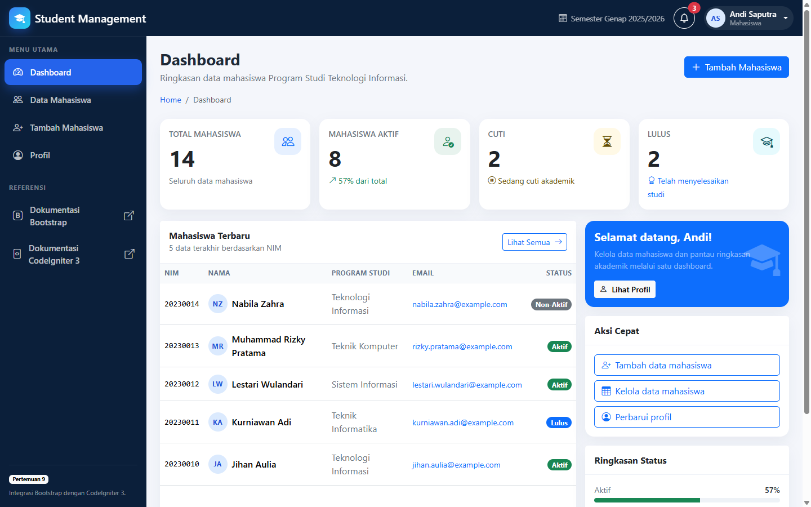

# 01 — Pengantar Bootstrap, CodeIgniter 3, dan Konsep MVC

## Tujuan Materi

Setelah membaca materi ini, mahasiswa diharapkan mampu:

1. Menjelaskan pengertian dan fungsi Bootstrap.
2. Menjelaskan pengertian CodeIgniter 3 dan pola MVC.
3. Menjelaskan hubungan controller dengan view pada CodeIgniter 3.
4. Menjelaskan mengapa framework CSS dapat diintegrasikan dengan framework PHP.
5. Membaca alur request aplikasi **Student Management Dashboard**.

---

## 1. Apa Itu Bootstrap?

**Bootstrap** adalah framework CSS open-source yang menyediakan kumpulan class siap pakai untuk membangun antarmuka web yang responsif. Bootstrap menyediakan:

- sistem grid 12 kolom;
- komponen UI: navbar, card, table, badge, button, modal, offcanvas, alert, pagination, form;
- utility class: `mt-3`, `mb-3`, `p-3`, `gap-3`, `d-flex`, `text-center`, dan sebagainya;
- JavaScript bawaan untuk komponen interaktif seperti dropdown, offcanvas, dan validasi form.

Dengan Bootstrap, pengembang tidak perlu menulis CSS dari nol untuk setiap komponen. Fokus pengembangan dapat diarahkan pada struktur aplikasi dan logika bisnis.

### Bootstrap Bukan Framework PHP

Bootstrap hanya mengatur **tampilan** di sisi browser (HTML, CSS, JavaScript). Bootstrap tidak mengenal database, controller, atau session. Oleh karena itu, Bootstrap perlu dipasangkan dengan bahasa server seperti PHP.

```text
PHP / CodeIgniter 3  →  menghasilkan HTML
Bootstrap            →  mempercantik HTML di browser
```

---

## 2. Apa Itu CodeIgniter 3?

**CodeIgniter 3** adalah framework PHP ringan dengan pola **MVC (Model–View–Controller)**. Framework ini menyediakan:

- routing URL;
- pemanggilan controller dan view;
- helper dan library;
- pengelolaan konfigurasi;
- validasi form;
- session;
- dan lain-lain.

Struktur dasar request CodeIgniter 3:

```text
Browser → index.php → Router → Controller → View → HTML → Browser
```

### Tiga Komponen MVC

| Komponen | Lokasi | Tugas |
|---|---|---|
| **Model** | `application/models/` | Mengambil/mengolah data |
| **View** | `application/views/` | Menampilkan HTML dan komponen Bootstrap |
| **Controller** | `application/controllers/` | Menerima request, memanggil model, memuat view |

Pada praktikum ini:

- **Model** `Mahasiswa_model.php` menyediakan data dummy.
- **Controller** `Dashboard.php`, `Mahasiswa.php`, `Profil.php` mengatur halaman.
- **View** berisi HTML + class Bootstrap, dipecah menjadi partial template.

---

## 3. Fungsi Bootstrap dalam Pengembangan Web

1. **Mempercepat pembuatan UI**  
   Cukup menambahkan class seperti `card`, `table`, `btn btn-primary`.

2. **Konsisten**  
   Semua tombol, form, dan tabel memiliki gaya yang seragam.

3. **Responsif**  
   Grid Bootstrap menyesuaikan lebar layar:
   ```html
   <div class="col-sm-6 col-xl-3">...</div>
   ```
   Artinya: 2 kolom pada layar kecil–menengah, 4 kolom pada layar besar.

4. **Mudah dirawat**  
   Ketika desain berubah, cukup ubah class atau variabel CSS, bukan menulis ulang CSS.

5. **Aksesibel**  
   Komponen Bootstrap sudah memiliki struktur HTML dan atribut ARIA dasar.

---

## 4. Konsep Integrasi Framework CSS dengan Framework PHP

Integrasi dilakukan dengan menghubungkan **file statis** milik Bootstrap ke halaman HTML yang dihasilkan CodeIgniter.

### Tanpa CodeIgniter

```html
<link rel="stylesheet" href="css/bootstrap.min.css">
```

### Dengan CodeIgniter 3

```php
<link rel="stylesheet" href="<?= base_url('assets/bootstrap/css/bootstrap.min.css'); ?>">
```

`base_url()` menghasilkan URL absolut menuju folder project, misalnya:

```text
http://localhost/pengantar/assets/bootstrap/css/bootstrap.min.css
```

Dengan demikian, file CSS tetap ditemukan meskipun aplikasi berada di subfolder `htdocs/pengantar`.

### Tiga Lapisan Integrasi

```text
1. File fisik       : assets/bootstrap/css/bootstrap.min.css
2. Konfigurasi URL  : base_url() → http://localhost/pengantar/
3. View             : <link rel="stylesheet" href="base_url + assets/...">
```

Jika salah satu lapisan salah, Bootstrap tidak akan tampil.

---

## 5. Konsep MVC dan Hubungan Controller–View

### Contoh Alur Halaman Dashboard

```text
1. Pengguna membuka:
   http://localhost/pengantar/index.php/dashboard

2. Router CodeIgniter membaca segmen URL:
   controller = dashboard
   method     = index

3. Controller Dashboard::index() berjalan:
   - memuat model Mahasiswa_model
   - menghitung statistik
   - menyiapkan array $data

4. Controller memanggil view:
   $this->load->view('templates/header', $data);
   $this->load->view('templates/navbar', $data);
   $this->load->view('templates/sidebar', $data);
   $this->load->view('dashboard/index', $data);
   $this->load->view('templates/footer', $data);
   $this->load->view('templates/scripts', $data);

5. View menghasilkan HTML.

6. Browser menerima HTML + file CSS/JS Bootstrap.
```

### Ilustrasi Alur Kerja

```text
┌──────────┐      HTTP Request      ┌───────────────┐
│ Browser  │ ─────────────────────► │  index.php    │
└──────────┘                        └───────┬───────┘
      ▲                                     │
      │                                     ▼
      │                             ┌───────────────┐
      │                             │   Router      │
      │                             └───────┬───────┘
      │                                     │
      │                                     ▼
      │                             ┌───────────────┐
      │                             │  Controller   │◄──── Model
      │                             └───────┬───────┘       │
      │                                     │               ▼
      │                                     ▼         ┌──────────┐
      │                             ┌───────────────┐ │ Data     │
      │                             │     View      │ │ dummy/DB │
      │                             │ + Bootstrap   │ └──────────┘
      │                             └───────┬───────┘
      │                                     │
      └────────── HTML + CSS/JS ◄───────────┘
```

---

## 6. Contoh Implementasi Sederhana

### 6.1 Route

File: `application/config/routes.php`

```php
$route['default_controller'] = 'dashboard';
$route['dashboard'] = 'dashboard/index';
$route['mahasiswa'] = 'mahasiswa/index';
$route['profil'] = 'profil/index';
```

### 6.2 Controller

File: `application/controllers/Dashboard.php` (disederhanakan)

```php
<?php
defined('BASEPATH') OR exit('No direct script access allowed');

class Dashboard extends CI_Controller {

    public function __construct()
    {
        parent::__construct();
        $this->load->model('mahasiswa_model');
    }

    public function index()
    {
        $data = array(
            'title'           => 'Dashboard',
            'active_menu'     => 'dashboard',
            'total_mahasiswa' => $this->mahasiswa_model->count_all(),
            'total_aktif'     => $this->mahasiswa_model->count_by_status('Aktif'),
        );

        $this->load->view('templates/header', $data);
        $this->load->view('templates/navbar', $data);
        $this->load->view('templates/sidebar', $data);
        $this->load->view('dashboard/index', $data);
        $this->load->view('templates/footer', $data);
        $this->load->view('templates/scripts', $data);
    }
}
```

Penjelasan:

- `__construct()` memuat model agar dapat dipakai di semua method controller.
- `$data` adalah array yang dikirim ke view.
- `$this->load->view()` memanggil file view sesuai urutan.
- Data `$data` otomatis tersedia sebagai variabel di dalam view.

### 6.3 View dengan Bootstrap

File: `application/views/dashboard/index.php` (potongan)

```php
<main class="app-main">
    <div class="container-fluid px-3 px-lg-4 py-4">
        <h1 class="h3 fw-bold mb-1">Dashboard</h1>

        <div class="row g-3 mt-2">
            <div class="col-sm-6 col-xl-3">
                <div class="card stat-card h-100">
                    <div class="card-body">
                        <p class="text-secondary small text-uppercase fw-semibold mb-2">
                            Total Mahasiswa
                        </p>
                        <h2 class="display-6 fw-bold mb-1">
                            <?= (int) $total_mahasiswa; ?>
                        </h2>
                    </div>
                </div>
            </div>
        </div>
    </div>
</main>
```

### 6.4 Hasil

Controller mengirim `$total_mahasiswa`; view menampilkannya di dalam **Bootstrap Card**. Bootstrap mengatur tampilan kartu, sedangkan CodeIgniter mengatur data dan pemanggilan view.



---

## 7. Mengapa Template Perlu Dipecah?

Pada aplikasi dengan banyak halaman, bagian seperti navbar, sidebar, dan footer selalu sama. Jika HTML navbar ditulis ulang di setiap view:

- kode menjadi panjang dan berulang;
- perubahan menu harus dilakukan di banyak file;
- risiko inkonsistensi tinggi.

Dengan partial view:

```php
$this->load->view('templates/navbar', $data);
```

satu file navbar dipakai oleh seluruh halaman. Inilah inti materi berikutnya: **memecah template Bootstrap**.

---

## 8. Rangkuman

| Konsep | Inti |
|---|---|
| Bootstrap | Framework CSS untuk UI responsif |
| CodeIgniter 3 | Framework PHP dengan pola MVC |
| Integrasi | Memanggil file CSS/JS Bootstrap dari view via `base_url()` |
| Controller | Mengatur data dan memanggil view |
| View | Menampilkan HTML + class Bootstrap |
| Partial view | Potongan template yang dapat digunakan ulang |
| Alur | Request → Router → Controller → View → HTML |

## Latihan Kecil

1. Sebutkan tiga komponen MVC dan tugasnya.
2. Mengapa Bootstrap disebut framework CSS, bukan framework PHP?
3. Apa fungsi `$this->load->view()`?
4. Apa yang terjadi jika `base_url()` salah?
5. Mengapa navbar sebaiknya dijadikan partial view?
