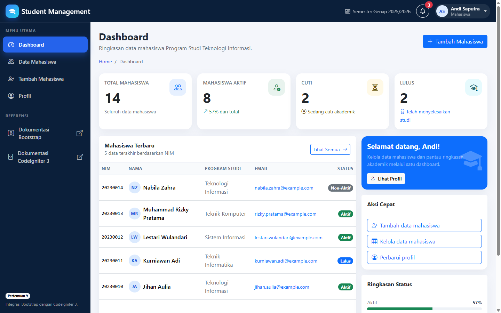

# 03 — Memecah Template Bootstrap menjadi Partial View

## Tujuan Materi

Setelah membaca materi ini, mahasiswa diharapkan mampu:

1. Menjelaskan pengertian template dan partial view.
2. Menjelaskan alasan template perlu dipecah.
3. Memisahkan header, navbar, sidebar, footer, dan JavaScript.
4. Memanggil partial view dengan `$this->load->view()`.
5. Membandingkan pendekatan satu file utuh dengan template terpisah.

---

## 1. Apa Itu Template dan Partial View?

**Template** adalah kerangka tampilan yang menentukan susunan halaman: bagian atas, menu, sidebar, area konten, dan footer.

**Partial view** adalah potongan template yang disimpan dalam file view terpisah dan dipanggil kembali dari controller. Contoh:

```text
templates/header.php   → <head>, CSS, pembuka layout
templates/navbar.php   → navbar atas
templates/sidebar.php  → menu samping
templates/footer.php   → footer + penutup layout
templates/scripts.php  → JavaScript + penutup HTML
```

Dengan partial view, satu file dapat dipakai oleh **semua halaman**.

---

## 2. Mengapa Template Perlu Dipecah?

### Masalah pada Satu File Besar

Bayangkan tiga halaman: dashboard, data mahasiswa, dan profil. Jika setiap file berisi navbar, sidebar, dan footer:

```text
dashboard/index.php   → navbar + sidebar + konten + footer
mahasiswa/index.php   → navbar + sidebar + konten + footer
profil/index.php      → navbar + sidebar + konten + footer
```

Akibatnya:

1. **Duplikasi kode** — navbar ditulis tiga kali.
2. **Sulit dirawat** — menambah menu harus mengedit semua file.
3. **Rawan tidak konsisten** — satu halaman bisa lupa footer.
4. **File menjadi panjang** — logika tampilan bercampur.
5. **Sulit dikerjakan tim** — konflik edit lebih besar.

### Keuntungan Partial View

| Aspek | Satu file utuh | Partial view |
|---|---|---|
| Duplikasi | Tinggi | Tidak ada |
| Perubahan navbar | Edit banyak file | Edit satu file |
| Konsistensi | Rawan salah | Terjamin |
| Keterbacaan | Rendah | Tinggi |
| Kolaborasi | Konflik besar | Lebih mudah |

---

## 3. Struktur Template pada Project Ini

```text
application/views/
├── templates/
│   ├── header.php
│   ├── navbar.php
│   ├── sidebar.php
│   ├── footer.php
│   └── scripts.php
├── dashboard/
│   └── index.php
├── mahasiswa/
│   ├── index.php
│   └── form.php
└── profil/
    └── index.php
```

### Pembagian Tanggung Jawab

| File | Isi | Membuka/Menutup |
|---|---|---|
| `header.php` | `<!doctype>`, `<head>`, CSS, `<body>`, pembuka `.app-shell` | Membuka layout |
| `navbar.php` | Navbar atas | — |
| `sidebar.php` | Menu samping (offcanvas-lg) | — |
| konten halaman | `<main class="app-main">` + isi | — |
| `footer.php` | Footer + penutup `.app-shell` | Menutup layout |
| `scripts.php` | JavaScript + `</body></html>` | Menutup dokumen |

> Penting: pembuka dan penutup layout harus seimbang. `header.php` membuka `<div class="app-shell">`, sedangkan `footer.php` menutupnya.

---

## 4. Sebelum Template Dipecah

Berikut contoh **satu file view** yang berisi seluruh HTML. Kode disederhanakan agar mudah dibaca.

File: `application/views/dashboard/index_utuh.php`

```php
<?php defined('BASEPATH') OR exit('No direct script access allowed'); ?>
<!doctype html>
<html lang="id">
<head>
    <meta charset="utf-8">
    <meta name="viewport" content="width=device-width, initial-scale=1">
    <title>Dashboard</title>
    <link rel="stylesheet" href="<?= base_url('assets/bootstrap/css/bootstrap.min.css'); ?>">
</head>
<body>
<div class="app-shell">

    <!-- NAVBAR: ditulis ulang di setiap halaman -->
    <nav class="navbar topbar px-3">
        <a class="navbar-brand text-white" href="<?= site_url('dashboard'); ?>">
            Student Management
        </a>
        <button class="btn btn-outline-light d-lg-none"
            data-bs-toggle="offcanvas" data-bs-target="#sidebarMenu">
            Menu
        </button>
    </nav>

    <!-- SIDEBAR: ditulis ulang di setiap halaman -->
    <aside class="sidebar offcanvas-lg offcanvas-start" id="sidebarMenu">
        <ul class="nav flex-column sidebar-nav p-2">
            <li><a class="nav-link active" href="<?= site_url('dashboard'); ?>">Dashboard</a></li>
            <li><a class="nav-link" href="<?= site_url('mahasiswa'); ?>">Data Mahasiswa</a></li>
            <li><a class="nav-link" href="<?= site_url('profil'); ?>">Profil</a></li>
        </ul>
    </aside>

    <!-- KONTEN -->
    <main class="app-main">
        <div class="container-fluid p-4">
            <h1>Dashboard</h1>
            <p>Total mahasiswa: <?= $total_mahasiswa; ?></p>

            <div class="card">
                <div class="card-body">
                    <h2 class="h6">Mahasiswa Terbaru</h2>
                    <table class="table table-hover">
                        <thead>
                            <tr><th>NIM</th><th>Nama</th><th>Status</th></tr>
                        </thead>
                        <tbody>
                            <?php foreach ($mahasiswa_terbaru as $m): ?>
                                <tr>
                                    <td><?= $m['nim']; ?></td>
                                    <td><?= $m['nama']; ?></td>
                                    <td><?= $m['status']; ?></td>
                                </tr>
                            <?php endforeach; ?>
                        </tbody>
                    </table>
                </div>
            </div>
        </div>
    </main>

    <!-- FOOTER: ditulis ulang di setiap halaman -->
    <footer class="app-footer p-3">
        &copy; 2026 Student Management
    </footer>
</div>

<script src="<?= base_url('assets/bootstrap/js/bootstrap.bundle.min.js'); ?>"></script>
</body>
</html>
```

### Kelemahan

Jika ingin menambah menu **Tambah Mahasiswa**, kita harus mengedit:

- `dashboard/index_utuh.php`
- `mahasiswa/index_utuh.php`
- `profil/index_utuh.php`

Jika salah satu terlewat, navigasi menjadi tidak konsisten.

---

## 5. Setelah Template Dipecah

### 5.1 `templates/header.php`

```php
<?php defined('BASEPATH') OR exit('No direct script access allowed'); ?>
<!doctype html>
<html lang="id">
<head>
    <meta charset="utf-8">
    <meta name="viewport" content="width=device-width, initial-scale=1">
    <title><?= html_escape(isset($title) ? $title : 'Dashboard'); ?> &middot; Student Management</title>

    <link rel="stylesheet" href="<?= base_url('assets/bootstrap/css/bootstrap.min.css'); ?>">
    <link rel="stylesheet" href="<?= base_url('assets/bootstrap-icons/bootstrap-icons.min.css'); ?>">
    <link rel="stylesheet" href="<?= base_url('assets/css/custom.css'); ?>">
</head>
<body>
<div class="app-shell">
```

**Penjelasan:**

- Berisi bagian `<head>` yang selalu sama.
- `$title` berasal dari controller; jika tidak ada, dipakai "Dashboard".
- `base_url()` membuat URL aset selalu benar.
- Membuka `<div class="app-shell">` yang akan ditutup di footer.

### 5.2 `templates/navbar.php`

```php
<nav class="navbar topbar px-2 px-lg-3" aria-label="Navigasi utama">
    <div class="container-fluid px-0">
        <button class="btn btn-outline-light btn-sm d-lg-none me-2" type="button"
            data-bs-toggle="offcanvas" data-bs-target="#sidebarMenu"
            aria-controls="sidebarMenu" aria-label="Buka menu navigasi">
            <i class="bi bi-list fs-5"></i>
        </button>

        <a class="navbar-brand d-flex align-items-center gap-2 text-white me-0"
            href="<?= site_url('dashboard'); ?>">
            <span class="brand-mark"><i class="bi bi-mortarboard-fill"></i></span>
            <span class="d-none d-sm-inline fw-semibold">Student Management</span>
        </a>

        <!-- dropdown notifikasi dan profil -->
    </div>
</nav>
```

**Penjelasan:**

- Tombol menu hanya tampil di bawah breakpoint `lg` (`d-lg-none`).
- `data-bs-toggle="offcanvas"` dan `data-bs-target="#sidebarMenu"` menghubungkan tombol dengan sidebar.
- `site_url()` dipakai untuk URL controller.
- Navbar cukup diubah di satu file untuk semua halaman.

### 5.3 `templates/sidebar.php`

```php
<?php
$active = isset($active_menu) ? $active_menu : 'dashboard';
?>
<aside class="sidebar offcanvas-lg offcanvas-start" tabindex="-1"
    id="sidebarMenu" aria-labelledby="sidebarMenuLabel">

    <div class="offcanvas-header d-lg-none">
        <h5 class="offcanvas-title" id="sidebarMenuLabel">Menu</h5>
        <button type="button" class="btn-close btn-close-white"
            data-bs-dismiss="offcanvas" aria-label="Tutup"></button>
    </div>

    <div class="offcanvas-body sidebar-body p-0">
        <ul class="nav flex-column sidebar-nav px-2">
            <li class="nav-item">
                <a class="nav-link <?= $active === 'dashboard' ? 'active' : ''; ?>"
                    href="<?= site_url('dashboard'); ?>">
                    <i class="bi bi-speedometer2"></i>
                    <span>Dashboard</span>
                </a>
            </li>
            <li class="nav-item">
                <a class="nav-link <?= $active === 'mahasiswa' ? 'active' : ''; ?>"
                    href="<?= site_url('mahasiswa'); ?>">
                    <i class="bi bi-people"></i>
                    <span>Data Mahasiswa</span>
                </a>
            </li>
            <li class="nav-item">
                <a class="nav-link <?= $active === 'mahasiswa-form' ? 'active' : ''; ?>"
                    href="<?= site_url('mahasiswa/tambah'); ?>">
                    <i class="bi bi-person-plus"></i>
                    <span>Tambah Mahasiswa</span>
                </a>
            </li>
            <li class="nav-item">
                <a class="nav-link <?= $active === 'profil' ? 'active' : ''; ?>"
                    href="<?= site_url('profil'); ?>">
                    <i class="bi bi-person-circle"></i>
                    <span>Profil</span>
                </a>
            </li>
        </ul>
    </div>
</aside>
```

**Penjelasan:**

- `$active_menu` dikirim controller untuk menandai menu aktif.
- Class `active` memberi warna Bootstrap biru pada menu.
- `offcanvas-lg` membuat sidebar:
  - **desktop (≥992px)**: tampil tetap;
  - **mobile (<992px)**: menjadi panel geser.

### 5.4 `templates/footer.php`

```php
<footer class="app-footer px-3 px-lg-4 py-3">
    <div class="d-flex flex-column flex-md-row justify-content-between gap-2 small text-secondary">
        <span>&copy; <?= date('Y'); ?> Student Management Dashboard.</span>
        <span class="d-inline-flex align-items-center gap-2">
            <span class="badge rounded-pill text-bg-primary-subtle text-primary-emphasis">
                CodeIgniter 3.1.13
            </span>
            <span class="badge rounded-pill text-bg-info-subtle text-info-emphasis">
                Bootstrap 5.3.3
            </span>
        </span>
    </div>
</footer>
</div><!-- /.app-shell -->
```

**Penjelasan:**

- `date('Y')` membuat tahun otomatis.
- `</div><!-- /.app-shell -->` menutup layout yang dibuka di `header.php`.
- Komentar HTML membantu menandai elemen penutup.

### 5.5 `templates/scripts.php`

```php
<script src="<?= base_url('assets/bootstrap/js/bootstrap.bundle.min.js'); ?>"></script>
<script src="<?= base_url('assets/js/app.js'); ?>"></script>
</body>
</html>
```

**Penjelasan:**

- Dimuat terakhir agar DOM sudah siap.
- `app.js` menangani validasi Bootstrap dan penutupan sidebar mobile.
- Menutup `</body>` dan `</html>`.

### 5.6 Konten Halaman

File: `application/views/dashboard/index.php` (potongan)

```php
<main class="app-main">
    <div class="container-fluid px-3 px-lg-4 py-4">
        <h1 class="h3 fw-bold mb-1">Dashboard</h1>
        <p class="text-secondary mb-0">Ringkasan data mahasiswa.</p>

        <div class="row g-3 mt-2">
            <div class="col-sm-6 col-xl-3">
                <div class="card stat-card h-100">
                    <div class="card-body">
                        <p class="text-secondary small text-uppercase fw-semibold mb-2">
                            Total Mahasiswa
                        </p>
                        <h2 class="display-6 fw-bold mb-1"><?= (int) $total_mahasiswa; ?></h2>
                    </div>
                </div>
            </div>
        </div>
    </div>
</main>
```

Konten halaman **tidak** lagi berisi navbar/sidebar/footer.

---

## 6. Memanggil Partial View dari Controller

File: `application/controllers/Dashboard.php`

```php
public function index()
{
    $data = array(
        'title'             => 'Dashboard',
        'active_menu'       => 'dashboard',
        'total_mahasiswa'   => $this->mahasiswa_model->count_all(),
        'total_aktif'       => $this->mahasiswa_model->count_by_status('Aktif'),
        'total_cuti'        => $this->mahasiswa_model->count_by_status('Cuti'),
        'total_lulus'       => $this->mahasiswa_model->count_by_status('Lulus'),
        'mahasiswa_terbaru' => $this->mahasiswa_model->get_latest(5),
    );

    $this->load->view('templates/header', $data);
    $this->load->view('templates/navbar', $data);
    $this->load->view('templates/sidebar', $data);
    $this->load->view('dashboard/index', $data);
    $this->load->view('templates/footer', $data);
    $this->load->view('templates/scripts', $data);
}
```

### Urutan Pemanggilan Itu Penting

```text
header   → membuka <html>, <head>, <body>, .app-shell
navbar   → navbar
sidebar  → sidebar
konten   → <main> isi halaman </main>
footer   → footer + menutup .app-shell
scripts  → JS + </body></html>
```

Jika `footer` dipanggil sebelum konten, HTML menjadi tidak valid.

### Kenapa `$data` Dikirim ke Setiap View?

Setiap view membutuhkan variabel yang berbeda:

- `header` butuh `$title`;
- `sidebar` butuh `$active_menu`;
- `dashboard/index` butuh `$total_mahasiswa`, dan seterusnya.

Mengirim `$data` ke semua view memastikan variabel tersedia. CodeIgniter juga menyimpan data view yang sudah dimuat, tetapi mengirim ulang `$data` membuat kode lebih eksplisit dan mudah dibaca.

---

## 7. Perbandingan Jumlah Baris

| Pendekatan | Navbar | Sidebar | Footer | Risiko duplikasi |
|---|---|---|---|---|
| Satu file per halaman | 3 salinan | 3 salinan | 3 salinan | Tinggi |
| Partial view | 1 file | 1 file | 1 file | Tidak ada |

Dengan empat halaman saja, penghematan dan konsistensi sudah terasa. Pada aplikasi nyata dengan puluhan halaman, partial view menjadi kebutuhan wajib.

---

## 8. Kesalahan Umum Saat Memecah Template

| Kesalahan | Akibat |
|---|---|
| Lupa memanggil `footer` | Layout tidak tertutup, tampilan rusak |
| Menutup `.app-shell` di halaman konten | Footer berada di luar layout |
| Mengirim `$data` hanya ke satu view | `Undefined variable` di view lain |
| Menulis `<html>` di setiap partial | HTML ganda |
| Menaruh `custom.css` sebelum Bootstrap | Custom CSS tertimpa |
| Menaruh `scripts.php` di dalam `<main>` | Script dimuat di tempat yang salah |

---

## 9. Hasil Akhir

Setelah template dipecah, halaman dashboard tetap tampil utuh, tetapi kode lebih rapi:



Perhatikan bahwa navbar, sidebar, dan footer sama di semua halaman. Yang berubah hanya area konten dan menu aktif.

---

## 10. Rangkuman

| Bagian | File | Peran |
|---|---|---|
| Head + pembuka layout | `templates/header.php` | CSS, `<body>`, `.app-shell` |
| Navigasi atas | `templates/navbar.php` | Brand, tombol menu, dropdown |
| Navigasi samping | `templates/sidebar.php` | Menu + status aktif |
| Footer + penutup | `templates/footer.php` | Footer, `</div>` |
| JavaScript | `templates/scripts.php` | Bundle + app.js, penutup dokumen |
| Konten | `dashboard/`, `mahasiswa/`, `profil/` | Isi halaman |

**Kunci utama:** satu partial, dipakai banyak halaman; controller mengatur urutan pemanggilan.

## Latihan Kecil

1. Tambahkan menu "Laporan" pada sidebar, lalu pastikan muncul di semua halaman.
2. Ubah teks footer di `footer.php`; periksa seluruh halaman ikut berubah.
3. Pindahkan `scripts.php` ke sebelum `</main>` dan amati akibatnya.
4. Buat partial baru `templates/breadcrumb.php` untuk menggantikan breadcrumb yang ditulis di setiap halaman.
5. Jelaskan mengapa `$active_menu` perlu dikirim dari controller.
