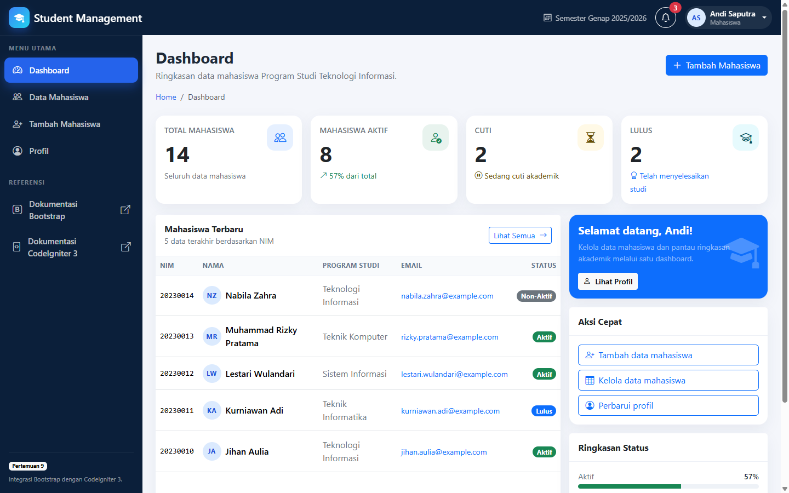
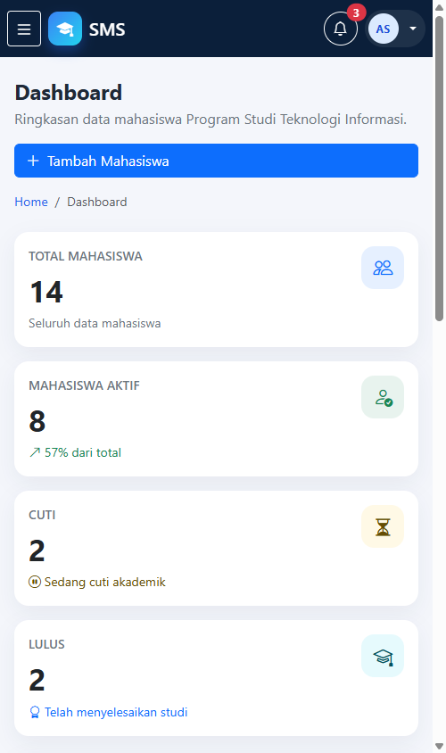
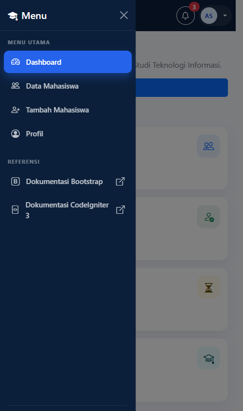
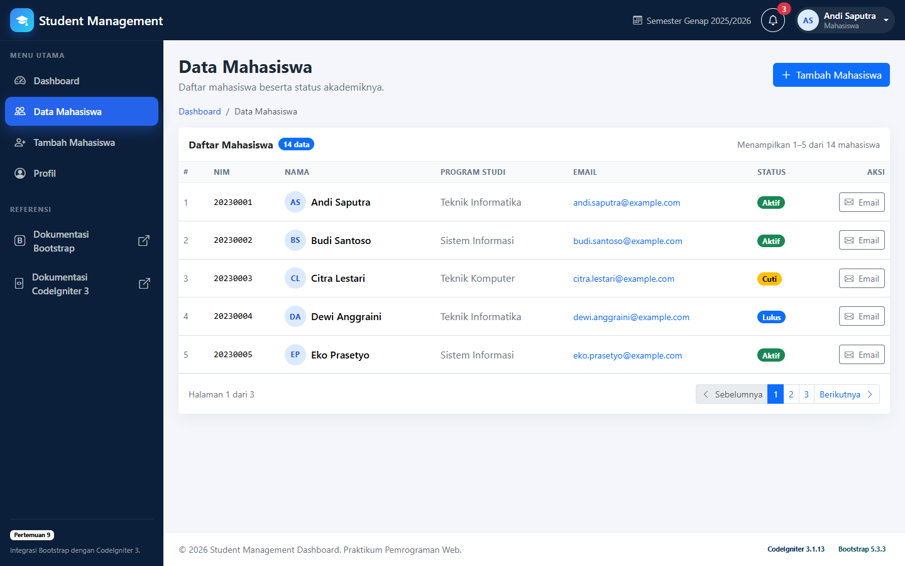
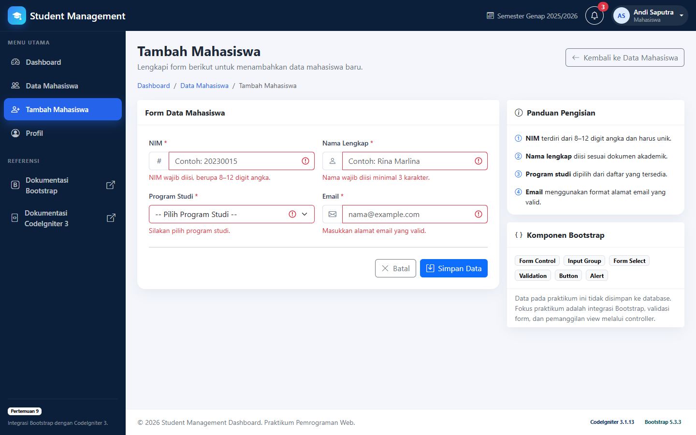

# 04 — Langkah Praktikum

Panduan ini terdiri dari **9 praktikum** yang disusun bertahap. Setiap praktikum memiliki tujuan, langkah kerja, file yang dibuat/diubah, source code, penjelasan, hasil yang diharapkan, dan tugas kecil.

> **Waktu:** sesuaikan dengan RPS. Praktikum 1–3 dapat diselesaikan pada sesi perkuliahan 2 × 40 menit; Praktikum 4–9 pada sesi diskusi dan praktik 2 × 3 × 40 menit.

---

## Praktikum 1 — Persiapan Lingkungan Pengembangan

### Tujuan

- Memastikan PHP dan web server siap digunakan.
- Menyiapkan folder kerja.
- Memahami struktur project CodeIgniter 3.

### Langkah Kerja

1. **Pastikan PHP tersedia.**

   Buka terminal/Command Prompt:

   ```bash
   php -v
   ```

   Contoh output:

   ```text
   PHP 8.1.34 (cli) (built: ...)
   ```

   Jika perintah tidak dikenali, gunakan PHP dari XAMPP:

   ```bash
   C:\xampp\php\php.exe -v
   ```

2. **Jalankan web server.**
   - XAMPP: Start **Apache**.
   - Laragon: Start All.
   - Atau gunakan PHP built-in server (lihat Praktikum 2).

3. **Siapkan folder project.**

   ```text
   C:\xampp\htdocs\pengantar
   ```

   atau

   ```text
   C:\laragon\www\pengantar
   ```

4. **Siapkan browser dan code editor.**
   - Chrome/Edge/Firefox.
   - VS Code/Sublime/Notepad++.

### File yang Dibuat/Dimodifikasi

Belum ada file aplikasi. Hanya folder kerja.

### Hasil yang Diharapkan

- `php -v` menampilkan versi PHP.
- Folder `pengantar` siap di dalam `htdocs`/`www`.
- Web server berjalan.

### Tugas Kecil

Tuliskan versi PHP, web server, dan editor yang kamu gunakan pada lembar kerja.

---

## Praktikum 2 — Membuat Project CodeIgniter 3

### Tujuan

- Memperoleh core CodeIgniter 3.1.13 secara resmi.
- Mengatur konfigurasi dasar.
- Menampilkan halaman pertama melalui controller dan view.

### Langkah Kerja

#### 2.1 Mengunduh CodeIgniter 3.1.13

Sumber resmi:

- Halaman unduh: <https://codeigniter.com/download>
- GitHub release: <https://github.com/bcit-ci/CodeIgniter/archive/refs/tags/3.1.13.zip>

Ekstrak sehingga struktur menjadi:

```text
pengantar/
├── application/
├── system/
├── index.php
├── license.txt
└── readme.rst
```

> **Jangan mengubah isi folder `system/`.** Folder tersebut adalah core framework.

#### 2.2 Mengatur `base_url`

File: `application/config/config.php`

```php
$config['base_url'] = '';
if (isset($_SERVER['HTTP_HOST']))
{
    $scheme = ( ! empty($_SERVER['HTTPS']) && $_SERVER['HTTPS'] !== 'off') ? 'https' : 'http';
    $base_path = rtrim(str_replace('\\', '/', dirname($_SERVER['SCRIPT_NAME'])), '/');
    $config['base_url'] = $scheme.'://'.$_SERVER['HTTP_HOST'].$base_path.'/';
}
else
{
    $config['base_url'] = 'http://localhost/pengantar/';
}
```

Penjelasan: `base_url` menyesuaikan host dan folder project, sehingga dapat berjalan di XAMPP maupun PHP built-in server.

Tetap gunakan:

```php
$config['index_page'] = 'index.php';
```

#### 2.3 Mengatur session

Masih di `config.php`:

```php
$config['encryption_key'] = 'praktikum-ci3-bootstrap-2025-key';
$config['sess_save_path'] = APPPATH.'cache/sessions';
```

Buat folder:

```text
application/cache/sessions/
```

Penjelasan: folder ini menyimpan file session agar tidak bergantung pada `session.save_path` PHP yang kadang kosong.

#### 2.4 Autoload library dan helper

File: `application/config/autoload.php`

```php
$autoload['libraries'] = array('session');
$autoload['helper'] = array('url', 'status');
```

- `session` → untuk flashdata notifikasi.
- `url` → menyediakan `base_url()`, `site_url()`.
- `status` → helper buatan sendiri (dibuat pada Praktikum 7).

> Jika `status_helper.php` belum ada, autoload helper `status` akan memunculkan error. Untuk sementara, gunakan `array('url')` lalu tambahkan `status` pada Praktikum 7.

#### 2.5 Membuat route

File: `application/config/routes.php`

```php
$route['default_controller'] = 'dashboard';
$route['404_override'] = '';
$route['translate_uri_dashes'] = FALSE;

$route['dashboard'] = 'dashboard/index';
$route['mahasiswa'] = 'mahasiswa/index';
$route['mahasiswa/tambah'] = 'mahasiswa/tambah';
$route['mahasiswa/page/(:num)'] = 'mahasiswa/index/$1';
$route['profil'] = 'profil/index';
```

#### 2.6 Membuat controller dan view pertama

File: `application/controllers/Dashboard.php`

```php
<?php
defined('BASEPATH') OR exit('No direct script access allowed');

class Dashboard extends CI_Controller {

    public function index()
    {
        $data['title'] = 'Dashboard';

        $this->load->view('dashboard/index', $data);
    }
}
```

File: `application/views/dashboard/index.php`

```html
<!doctype html>
<html lang="id">
<head>
    <meta charset="utf-8">
    <meta name="viewport" content="width=device-width, initial-scale=1">
    <title><?= $title; ?></title>
</head>
<body>
    <h1>Halo, CodeIgniter 3!</h1>
    <p>Project berhasil dijalankan.</p>
</body>
</html>
```

#### 2.7 Menjalankan project

**XAMPP/Laragon:**

```text
http://localhost/pengantar/
```

**PHP built-in server** (dari folder project):

```bash
php -S localhost:8080
```

```text
http://localhost:8080/
```

### File yang Dibuat/Dimodifikasi

```text
application/config/config.php
application/config/autoload.php
application/config/routes.php
application/controllers/Dashboard.php
application/views/dashboard/index.php
application/cache/sessions/          (folder baru)
```

### Penjelasan Source Code

| Kode | Fungsi |
|---|---|
| `default_controller = 'dashboard'` | Membuka dashboard otomatis di URL root |
| `Dashboard extends CI_Controller` | Controller utama halaman |
| `$this->load->view('dashboard/index', $data)` | Memanggil view dengan data |
| `$data['title']` | Variabel yang tersedia di view sebagai `$title` |
| `defined('BASEPATH') OR exit(...)` | Mencegah akses langsung ke file PHP |

### Hasil yang Diharapkan

Browser menampilkan teks:

```text
Halo, CodeIgniter 3!
Project berhasil dijalankan.
```

### Tugas Kecil

1. Ubah teks halaman menjadi "Selamat datang di Student Management".
2. Tambahkan variabel `$semester` dari controller dan tampilkan di view.
3. Jelaskan mengapa `default_controller` harus menunjuk ke controller yang ada.

---

## Praktikum 3 — Mengintegrasikan Bootstrap

### Tujuan

- Menyimpan aset Bootstrap secara lokal.
- Memanggil CSS dan JavaScript Bootstrap dengan `base_url()`.
- Memastikan Bootstrap benar-benar termuat.

### Langkah Kerja

#### 3.1 Menyiapkan folder aset

```text
assets/
├── bootstrap/
│   ├── css/
│   └── js/
├── bootstrap-icons/
│   ├── fonts/
├── css/
└── js/
```

#### 3.2 Menyalin file Bootstrap

Dari paket Bootstrap 5.3.3:

```text
bootstrap.min.css          → assets/bootstrap/css/
bootstrap.min.css.map      → assets/bootstrap/css/ (opsional)
bootstrap.bundle.min.js    → assets/bootstrap/js/
bootstrap.bundle.min.js.map→ assets/bootstrap/js/ (opsional)
```

Dari paket Bootstrap Icons 1.11.3:

```text
bootstrap-icons.min.css    → assets/bootstrap-icons/
fonts/bootstrap-icons.woff → assets/bootstrap-icons/fonts/
fonts/bootstrap-icons.woff2→ assets/bootstrap-icons/fonts/
```

#### 3.3 Memanggil CSS di `<head>`

Ubah `application/views/dashboard/index.php` menjadi:

```php
<!doctype html>
<html lang="id">
<head>
    <meta charset="utf-8">
    <meta name="viewport" content="width=device-width, initial-scale=1">
    <title><?= html_escape($title); ?></title>

    <link rel="stylesheet" href="<?= base_url('assets/bootstrap/css/bootstrap.min.css'); ?>">
    <link rel="stylesheet" href="<?= base_url('assets/bootstrap-icons/bootstrap-icons.min.css'); ?>">
    <link rel="stylesheet" href="<?= base_url('assets/css/custom.css'); ?>">
</head>
<body>
    <div class="container py-4">
        <h1 class="h3 fw-bold">Halo, CodeIgniter 3!</h1>
        <p class="text-secondary">Project berhasil dijalankan.</p>

        <button class="btn btn-primary">
            <i class="bi bi-check-circle me-1"></i> Tombol Bootstrap
        </button>

        <div class="alert alert-success mt-3" role="alert">
            Bootstrap berhasil diintegrasikan.
        </div>
    </div>

    <script src="<?= base_url('assets/bootstrap/js/bootstrap.bundle.min.js'); ?>"></script>
</body>
</html>
```

#### 3.4 Membuat `custom.css`

File: `assets/css/custom.css`

```css
body {
    background-color: #f4f6fb;
}
```

Tujuannya hanya menguji apakah CSS lokal termuat. CSS layout lengkap dibuat pada Praktikum 4–5.

#### 3.5 Memeriksa Network

1. Buka halaman di browser.
2. Tekan `F12` → tab **Network**.
3. Muat ulang halaman (`Ctrl + F5`).
4. Pastikan:

   ```text
   bootstrap.min.css        200
   bootstrap-icons.min.css  200
   custom.css               200
   bootstrap.bundle.min.js  200
   ```

#### 3.6 Menguji JavaScript Bootstrap

Tambahkan tombol dropdown:

```html
<div class="dropdown mt-3">
    <button class="btn btn-outline-primary dropdown-toggle" type="button"
        data-bs-toggle="dropdown" aria-expanded="false">
        Menu Dropdown
    </button>
    <ul class="dropdown-menu">
        <li><a class="dropdown-item" href="#">Item 1</a></li>
        <li><a class="dropdown-item" href="#">Item 2</a></li>
    </ul>
</div>
```

Jika dropdown terbuka saat diklik, `bootstrap.bundle.min.js` berhasil dimuat.

### File yang Dibuat/Dimodifikasi

```text
assets/bootstrap/css/bootstrap.min.css
assets/bootstrap/js/bootstrap.bundle.min.js
assets/bootstrap-icons/bootstrap-icons.min.css
assets/bootstrap-icons/fonts/bootstrap-icons.woff2
assets/css/custom.css
application/views/dashboard/index.php
```

### Penjelasan Source Code

| Kode | Fungsi |
|---|---|
| `base_url('assets/...')` | Menghasilkan URL absolut ke folder aset |
| `<link rel="stylesheet">` | Memuat CSS Bootstrap |
| `<script src="...bundle...">` | Memuat JS Bootstrap + Popper |
| `btn btn-primary` | Class tombol Bootstrap |
| `alert alert-success` | Komponen alert Bootstrap |
| `data-bs-toggle="dropdown"` | Mengaktifkan dropdown via JS Bootstrap |

### Hasil yang Diharapkan

- Tombol berwarna biru khas Bootstrap.
- Alert hijau tampil rapi.
- Ikon muncul.
- Dropdown berfungsi.
- Tidak ada 404 di tab Network.

### Tugas Kecil

1. Ganti tombol `btn-primary` menjadi `btn-danger`, amati perubahan.
2. Coba hapus `bootstrap.bundle.min.js`, lalu klik dropdown. Apa yang terjadi?
3. Cari satu 404 di Network (jika ada) dan perbaiki path-nya.

---

## Praktikum 4 — Membuat Halaman Dashboard

### Tujuan

- Membuat layout dashboard dengan Bootstrap.
- Menampilkan card statistik dan tabel mahasiswa terbaru.
- Menggunakan model untuk menyediakan data dummy.

### Langkah Kerja

#### 4.1 Membuat model data dummy

File: `application/models/Mahasiswa_model.php`

```php
<?php
defined('BASEPATH') OR exit('No direct script access allowed');

class Mahasiswa_model extends CI_Model {

    public function get_all()
    {
        return $this->data_mahasiswa();
    }

    public function get_latest($limit = 5)
    {
        $mahasiswa = $this->data_mahasiswa();

        usort($mahasiswa, function ($a, $b) {
            return strcmp($b['nim'], $a['nim']);
        });

        return array_slice($mahasiswa, 0, (int) $limit);
    }

    public function count_all()
    {
        return count($this->data_mahasiswa());
    }

    public function count_by_status($status)
    {
        $jumlah = 0;

        foreach ($this->data_mahasiswa() as $row)
        {
            if ($row['status'] === $status)
            {
                $jumlah++;
            }
        }

        return $jumlah;
    }

    private function data_mahasiswa()
    {
        return array(
            array(
                'nim'    => '20230001',
                'nama'   => 'Andi Saputra',
                'prodi'  => 'Teknik Informatika',
                'email'  => 'andi.saputra@example.com',
                'status' => 'Aktif',
            ),
            // ... tambahkan data lain (total 14 data pada project ini)
        );
    }
}
```

> Salin seluruh data dummy dari source code project agar hasil sama.

#### 4.2 Memperbarui controller

File: `application/controllers/Dashboard.php`

```php
<?php
defined('BASEPATH') OR exit('No direct script access allowed');

class Dashboard extends CI_Controller {

    public function __construct()
    {
        parent::__construct();
        $this->load->model('mahasiswa_model');
    }

    public function index()
    {
        $data = array(
            'title'             => 'Dashboard',
            'active_menu'       => 'dashboard',
            'total_mahasiswa'   => $this->mahasiswa_model->count_all(),
            'total_aktif'       => $this->mahasiswa_model->count_by_status('Aktif'),
            'total_cuti'        => $this->mahasiswa_model->count_by_status('Cuti'),
            'total_lulus'       => $this->mahasiswa_model->count_by_status('Lulus'),
            'mahasiswa_terbaru' => $this->mahasiswa_model->get_latest(5),
        );

        $this->load->view('dashboard/index', $data);
    }
}
```

#### 4.3 Membuat tampilan dashboard

File: `application/views/dashboard/index.php` (potongan inti)

```php
<?php
$persen_aktif = $total_mahasiswa > 0 ? round(($total_aktif / $total_mahasiswa) * 100) : 0;
?>
<!doctype html>
<html lang="id">
<head>
    <meta charset="utf-8">
    <meta name="viewport" content="width=device-width, initial-scale=1">
    <title><?= html_escape($title); ?></title>
    <link rel="stylesheet" href="<?= base_url('assets/bootstrap/css/bootstrap.min.css'); ?>">
    <link rel="stylesheet" href="<?= base_url('assets/bootstrap-icons/bootstrap-icons.min.css'); ?>">
    <link rel="stylesheet" href="<?= base_url('assets/css/custom.css'); ?>">
</head>
<body>
<div class="app-shell">
    <main class="app-main">
        <div class="container-fluid px-3 px-lg-4 py-4">
            <h1 class="h3 fw-bold mb-1">Dashboard</h1>
            <p class="text-secondary mb-0">Ringkasan data mahasiswa.</p>

            <nav aria-label="breadcrumb" class="mt-3">
                <ol class="breadcrumb">
                    <li class="breadcrumb-item"><a href="<?= site_url('dashboard'); ?>">Home</a></li>
                    <li class="breadcrumb-item active">Dashboard</li>
                </ol>
            </nav>

            <div class="row g-3 mt-2">
                <div class="col-sm-6 col-xl-3">
                    <div class="card stat-card h-100">
                        <div class="card-body d-flex justify-content-between">
                            <div>
                                <p class="text-secondary small text-uppercase fw-semibold mb-2">
                                    Total Mahasiswa
                                </p>
                                <h2 class="display-6 fw-bold mb-1"><?= (int) $total_mahasiswa; ?></h2>
                            </div>
                            <span class="stat-icon bg-primary bg-opacity-10 text-primary">
                                <i class="bi bi-people"></i>
                            </span>
                        </div>
                    </div>
                </div>

                <!-- Ulangi pola card untuk Aktif, Cuti, dan Lulus -->
            </div>

            <div class="card mt-4">
                <div class="card-header py-3">
                    <h2 class="h6 fw-bold mb-0">Mahasiswa Terbaru</h2>
                </div>
                <div class="table-responsive">
                    <table class="table table-hover align-middle mb-0">
                        <thead>
                            <tr>
                                <th>NIM</th>
                                <th>Nama</th>
                                <th>Program Studi</th>
                                <th>Status</th>
                            </tr>
                        </thead>
                        <tbody>
                            <?php foreach ($mahasiswa_terbaru as $m): ?>
                                <tr>
                                    <td class="font-monospace small"><?= html_escape($m['nim']); ?></td>
                                    <td class="fw-semibold"><?= html_escape($m['nama']); ?></td>
                                    <td class="text-secondary"><?= html_escape($m['prodi']); ?></td>
                                    <td>
                                        <span class="badge rounded-pill text-bg-success">
                                            <?= html_escape($m['status']); ?>
                                        </span>
                                    </td>
                                </tr>
                            <?php endforeach; ?>
                        </tbody>
                    </table>
                </div>
            </div>
        </div>
    </main>
</div>
</body>
</html>
```

> Pada project akhir, badge status menggunakan helper `status_badge()` dan template sudah dipecah.

#### 4.4 CSS layout dasar

File: `assets/css/custom.css`

```css
:root {
    --sms-navy: #0b1f3a;
    --sms-bg: #f4f6fb;
    --sms-sidebar-width: 260px;
    --sms-topbar-height: 64px;
}

body {
    background-color: var(--sms-bg);
}

.app-shell {
    display: grid;
    grid-template-columns: var(--sms-sidebar-width) minmax(0, 1fr);
    grid-template-rows: var(--sms-topbar-height) minmax(0, 1fr) auto;
    grid-template-areas:
        "topbar topbar"
        "sidebar main"
        "sidebar footer";
    min-height: 100vh;
}
```

> Layout grid lengkap beserta navbar/sidebar dibuat pada Praktikum 5.

### File yang Dibuat/Dimodifikasi

```text
application/models/Mahasiswa_model.php
application/controllers/Dashboard.php
application/views/dashboard/index.php
assets/css/custom.css
```

### Penjelasan Source Code

| Kode | Fungsi |
|---|---|
| `$this->load->model('mahasiswa_model')` | Memuat model agar bisa dipakai controller |
| `count_all()` | Menghitung total data dummy |
| `count_by_status('Aktif')` | Menghitung data dengan status tertentu |
| `$mahasiswa_terbaru` | Array 5 data terbaru untuk tabel |
| `foreach` di view | Menampilkan baris tabel secara dinamis |
| `html_escape()` | Mengamankan output teks |
| `card`, `table`, `badge` | Komponen Bootstrap |

### Hasil yang Diharapkan

Dashboard menampilkan:

- judul dan breadcrumb;
- empat card statistik;
- tabel mahasiswa terbaru;
- tampilan responsif (card menumpuk di layar kecil).

### Tugas Kecil

1. Tambahkan card "Non-Aktif" menggunakan `count_by_status('Non-Aktif')`.
2. Ubah urutan tabel menjadi nama A–Z.
3. Ganti warna card Cuti menjadi `bg-danger bg-opacity-10 text-danger`.

---

## Praktikum 5 — Membuat Navbar dan Sidebar

### Tujuan

- Menambahkan navbar atas dan sidebar kiri.
- Membuat sidebar responsif dengan `offcanvas-lg`.
- Mengatur menu aktif.

### Langkah Kerja

#### 5.1 Menambahkan navbar

Sisipkan di dalam `.app-shell`, sebelum `<main>`:

```php
<nav class="navbar topbar px-2 px-lg-3" aria-label="Navigasi utama">
    <div class="container-fluid px-0">
        <button class="btn btn-outline-light btn-sm d-lg-none me-2" type="button"
            data-bs-toggle="offcanvas" data-bs-target="#sidebarMenu"
            aria-controls="sidebarMenu" aria-label="Buka menu navigasi">
            <i class="bi bi-list fs-5"></i>
        </button>

        <a class="navbar-brand d-flex align-items-center gap-2 text-white" href="<?= site_url('dashboard'); ?>">
            <span class="brand-mark"><i class="bi bi-mortarboard-fill"></i></span>
            <span class="d-none d-sm-inline fw-semibold">Student Management</span>
        </a>

        <div class="ms-auto d-flex align-items-center gap-2">
            <div class="dropdown">
                <button class="btn btn-user dropdown-toggle d-flex align-items-center gap-2"
                    type="button" data-bs-toggle="dropdown" aria-expanded="false">
                    <span class="avatar-initials avatar-sm">AS</span>
                    <span class="d-none d-md-inline">Andi Saputra</span>
                </button>
                <ul class="dropdown-menu dropdown-menu-end">
                    <li><a class="dropdown-item" href="<?= site_url('profil'); ?>">Profil</a></li>
                    <li><a class="dropdown-item" href="<?= site_url('mahasiswa'); ?>">Data Mahasiswa</a></li>
                </ul>
            </div>
        </div>
    </div>
</nav>
```

#### 5.2 Menambahkan sidebar

Sisipkan setelah navbar:

```php
<aside class="sidebar offcanvas-lg offcanvas-start" tabindex="-1"
    id="sidebarMenu" aria-labelledby="sidebarMenuLabel">

    <div class="offcanvas-header d-lg-none">
        <h5 class="offcanvas-title" id="sidebarMenuLabel">Menu</h5>
        <button type="button" class="btn-close btn-close-white"
            data-bs-dismiss="offcanvas" aria-label="Tutup"></button>
    </div>

    <div class="offcanvas-body sidebar-body p-0">
        <ul class="nav flex-column sidebar-nav px-2 pt-3">
            <li class="nav-item">
                <a class="nav-link active" href="<?= site_url('dashboard'); ?>">
                    <i class="bi bi-speedometer2"></i>
                    <span>Dashboard</span>
                </a>
            </li>
            <li class="nav-item">
                <a class="nav-link" href="<?= site_url('mahasiswa'); ?>">
                    <i class="bi bi-people"></i>
                    <span>Data Mahasiswa</span>
                </a>
            </li>
            <li class="nav-item">
                <a class="nav-link" href="<?= site_url('mahasiswa/tambah'); ?>">
                    <i class="bi bi-person-plus"></i>
                    <span>Tambah Mahasiswa</span>
                </a>
            </li>
            <li class="nav-item">
                <a class="nav-link" href="<?= site_url('profil'); ?>">
                    <i class="bi bi-person-circle"></i>
                    <span>Profil</span>
                </a>
            </li>
        </ul>
    </div>
</aside>
```

#### 5.3 Menambahkan CSS topbar/sidebar

File: `assets/css/custom.css` (potongan)

```css
.app-shell {
    display: grid;
    grid-template-columns: var(--sms-sidebar-width) minmax(0, 1fr);
    grid-template-rows: var(--sms-topbar-height) minmax(0, 1fr) auto;
    grid-template-areas:
        "topbar topbar"
        "sidebar main"
        "sidebar footer";
    min-height: 100vh;
}

.topbar {
    grid-area: topbar;
    position: sticky;
    top: 0;
    z-index: 1030;
    min-height: var(--sms-topbar-height);
    background-color: var(--sms-navy);
}

.sidebar {
    grid-area: sidebar;
    background-color: var(--sms-navy);
}

.sidebar-nav .nav-link {
    display: flex;
    align-items: center;
    gap: 0.75rem;
    padding: 0.65rem 0.85rem;
    border-radius: 0.65rem;
    color: rgba(255, 255, 255, 0.72);
}

.sidebar-nav .nav-link.active {
    background-color: var(--sms-blue);
    color: #ffffff;
}

@media (min-width: 992px) {
    .sidebar.offcanvas-lg {
        position: sticky;
        top: var(--sms-topbar-height);
        height: calc(100vh - var(--sms-topbar-height));
        visibility: visible;
        transform: none;
        background-color: var(--sms-navy) !important;
    }
}
```

#### 5.4 Menguji sidebar di mobile

1. Buka DevTools (`F12`).
2. Aktifkan mode perangkat (`Ctrl + Shift + M`).
3. Pilih lebar 390px.
4. Klik tombol menu (ikon garis tiga).
5. Sidebar harus terbuka sebagai offcanvas.

### File yang Dibuat/Dimodifikasi

```text
application/views/dashboard/index.php
assets/css/custom.css
```

### Penjelasan Source Code

| Kode | Fungsi |
|---|---|
| `offcanvas-lg offcanvas-start` | Sidebar tetap di desktop, offcanvas di mobile |
| `data-bs-toggle="offcanvas"` | Menghubungkan tombol menu dengan sidebar |
| `d-lg-none` | Menyembunyikan tombol di desktop |
| `grid-template-areas` | Mengatur posisi topbar, sidebar, main, footer |
| `nav-link.active` | Menandai menu yang sedang dibuka |

### Hasil yang Diharapkan

Desktop:



Mobile:



Sidebar mobile:



### Tugas Kecil

1. Tambahkan menu "Laporan" pada sidebar.
2. Ubah warna sidebar menjadi `#111827`.
3. Pastikan tombol menu tidak muncul di desktop.

---

## Praktikum 6 — Memisahkan Template menjadi Partial View

### Tujuan

- Memindahkan header, navbar, sidebar, footer, dan scripts ke file terpisah.
- Memanggil partial view dari controller.
- Menghilangkan duplikasi HTML.

### Langkah Kerja

#### 6.1 Membuat folder template

```text
application/views/templates/
```

#### 6.2 Memindahkan bagian `<head>` dan pembuka layout

File: `application/views/templates/header.php`

```php
<?php defined('BASEPATH') OR exit('No direct script access allowed'); ?>
<!doctype html>
<html lang="id">
<head>
    <meta charset="utf-8">
    <meta name="viewport" content="width=device-width, initial-scale=1">
    <title><?= html_escape(isset($title) ? $title : 'Dashboard'); ?> &middot; Student Management</title>
    <link rel="stylesheet" href="<?= base_url('assets/bootstrap/css/bootstrap.min.css'); ?>">
    <link rel="stylesheet" href="<?= base_url('assets/bootstrap-icons/bootstrap-icons.min.css'); ?>">
    <link rel="stylesheet" href="<?= base_url('assets/css/custom.css'); ?>">
</head>
<body>
<div class="app-shell">
```

#### 6.3 Memindahkan navbar

Pindahkan seluruh `<nav class="navbar topbar">...</nav>` ke:

```text
application/views/templates/navbar.php
```

Tambahkan di baris pertama:

```php
<?php defined('BASEPATH') OR exit('No direct script access allowed'); ?>
```

#### 6.4 Memindahkan sidebar

Pindahkan seluruh `<aside class="sidebar ...">...</aside>` ke:

```text
application/views/templates/sidebar.php
```

Tambahkan logika menu aktif:

```php
<?php
defined('BASEPATH') OR exit('No direct script access allowed');

$active = isset($active_menu) ? $active_menu : 'dashboard';
?>
```

Gunakan pada setiap link:

```php
<a class="nav-link <?= $active === 'dashboard' ? 'active' : ''; ?>"
   href="<?= site_url('dashboard'); ?>">
```

#### 6.5 Memindahkan footer dan penutup layout

File: `application/views/templates/footer.php`

```php
<footer class="app-footer px-3 px-lg-4 py-3">
    <div class="d-flex justify-content-between small text-secondary">
        <span>&copy; <?= date('Y'); ?> Student Management Dashboard.</span>
        <span>Praktikum Pertemuan 9</span>
    </div>
</footer>
</div><!-- /.app-shell -->
```

#### 6.6 Memindahkan JavaScript

File: `application/views/templates/scripts.php`

```php
<script src="<?= base_url('assets/bootstrap/js/bootstrap.bundle.min.js'); ?>"></script>
<script src="<?= base_url('assets/js/app.js'); ?>"></script>
</body>
</html>
```

#### 6.7 Membersihkan view konten

File: `application/views/dashboard/index.php` sekarang hanya berisi `<main>`:

```php
<main class="app-main">
    <div class="container-fluid px-3 px-lg-4 py-4">
        <!-- seluruh konten dashboard -->
    </div>
</main>
```

#### 6.8 Memanggil partial dari controller

File: `application/controllers/Dashboard.php`

```php
$this->load->view('templates/header', $data);
$this->load->view('templates/navbar', $data);
$this->load->view('templates/sidebar', $data);
$this->load->view('dashboard/index', $data);
$this->load->view('templates/footer', $data);
$this->load->view('templates/scripts', $data);
```

#### 6.9 Membuat `app.js`

File: `assets/js/app.js`

```javascript
(function () {
    'use strict';

    var forms = document.querySelectorAll('.needs-validation');

    Array.prototype.forEach.call(forms, function (form) {
        form.addEventListener('submit', function (event) {
            if (!form.checkValidity()) {
                event.preventDefault();
                event.stopPropagation();
            }
            form.classList.add('was-validated');
        }, false);
    });

    var sidebar = document.getElementById('sidebarMenu');

    if (sidebar) {
        var links = sidebar.querySelectorAll('.nav-link');

        Array.prototype.forEach.call(links, function (link) {
            link.addEventListener('click', function () {
                if (window.innerWidth >= 992 || !window.bootstrap) {
                    return;
                }

                var instance = window.bootstrap.Offcanvas.getInstance(sidebar);
                if (instance) {
                    instance.hide();
                }
            });
        });
    }
})();
```

### File yang Dibuat/Dimodifikasi

```text
application/views/templates/header.php
application/views/templates/navbar.php
application/views/templates/sidebar.php
application/views/templates/footer.php
application/views/templates/scripts.php
application/views/dashboard/index.php
application/controllers/Dashboard.php
assets/js/app.js
```

### Penjelasan Source Code

| Kode | Fungsi |
|---|---|
| `$this->load->view('templates/header', $data)` | Memuat potongan header dengan data |
| `$active_menu` | Menentukan menu yang diberi class `active` |
| `</div><!-- /.app-shell -->` | Menutup layout yang dibuka header |
| Urutan load | Menentukan susunan HTML akhir |
| `window.bootstrap.Offcanvas` | Menutup sidebar setelah menu diklik di mobile |

### Hasil yang Diharapkan

Tampilan **sama persis** dengan Praktikum 5, tetapi:

- `dashboard/index.php` jauh lebih pendek;
- navbar/sidebar/footer hanya ada satu salinan;
- halaman lain dapat memakai partial yang sama.

### Tugas Kecil

1. Tambahkan menu di sidebar; pastikan berubah di semua halaman.
2. Buat halaman `profil` yang memakai partial yang sama.
3. Jelaskan mengapa `footer.php` harus dipanggil setelah konten.

---

## Praktikum 7 — Membuat Halaman Data Mahasiswa

### Tujuan

- Menampilkan tabel mahasiswa dengan pagination.
- Menggunakan badge status dan helper.
- Memakai partial template yang sudah dibuat.

### Langkah Kerja

#### 7.1 Menambahkan method pagination pada model

File: `application/models/Mahasiswa_model.php`

```php
public function get_paginated($limit, $offset)
{
    return array_slice($this->data_mahasiswa(), (int) $offset, (int) $limit);
}
```

#### 7.2 Membuat helper status

File: `application/helpers/status_helper.php`

```php
<?php
defined('BASEPATH') OR exit('No direct script access allowed');

if ( ! function_exists('status_badge'))
{
    function status_badge($status)
    {
        $warna = array(
            'Aktif'     => 'success',
            'Cuti'      => 'warning',
            'Lulus'     => 'primary',
            'Non-Aktif' => 'secondary',
        );

        $class = isset($warna[$status]) ? $warna[$status] : 'secondary';

        return '<span class="badge rounded-pill text-bg-'.$class.'">'
            .html_escape($status)
            .'</span>';
    }
}

if ( ! function_exists('avatar_initials'))
{
    function avatar_initials($nama)
    {
        $kata = preg_split('/\s+/', trim((string) $nama));
        $inisial = '';

        foreach (array_slice($kata, 0, 2) as $k)
        {
            $inisial .= strtoupper(substr($k, 0, 1));
        }

        return $inisial !== '' ? $inisial : 'M';
    }
}
```

Pastikan `application/config/autoload.php` memuat:

```php
$autoload['helper'] = array('url', 'status');
```

#### 7.3 Membuat controller Mahasiswa

File: `application/controllers/Mahasiswa.php`

```php
<?php
defined('BASEPATH') OR exit('No direct script access allowed');

class Mahasiswa extends CI_Controller {

    public function __construct()
    {
        parent::__construct();
        $this->load->model('mahasiswa_model');
        $this->load->helper('form');
    }

    public function index($page = 1)
    {
        $per_page    = 5;
        $total_data  = $this->mahasiswa_model->count_all();
        $total_pages = (int) ceil($total_data / $per_page);

        $page = (int) $page;
        if ($page < 1)
        {
            $page = 1;
        }
        elseif ($total_pages > 0 && $page > $total_pages)
        {
            $page = $total_pages;
        }

        $offset = ($page - 1) * $per_page;

        $data = array(
            'title'       => 'Data Mahasiswa',
            'active_menu' => 'mahasiswa',
            'mahasiswa'   => $this->mahasiswa_model->get_paginated($per_page, $offset),
            'page'        => $page,
            'per_page'    => $per_page,
            'total_data'  => $total_data,
            'total_pages' => $total_pages,
            'offset'      => $offset,
        );

        $this->load->view('templates/header', $data);
        $this->load->view('templates/navbar', $data);
        $this->load->view('templates/sidebar', $data);
        $this->load->view('mahasiswa/index', $data);
        $this->load->view('templates/footer', $data);
        $this->load->view('templates/scripts', $data);
    }
}
```

#### 7.4 Membuat view tabel

File: `application/views/mahasiswa/index.php` (potongan)

```php
<div class="card mt-3">
    <div class="card-header d-flex justify-content-between align-items-center py-3">
        <div class="d-flex align-items-center gap-2">
            <h2 class="h6 fw-bold mb-0">Daftar Mahasiswa</h2>
            <span class="badge rounded-pill text-bg-primary"><?= (int) $total_data; ?> data</span>
        </div>
        <span class="small text-secondary">
            Menampilkan <?= (int) ($offset + 1); ?>&ndash;<?= (int) min($offset + $per_page, $total_data); ?>
            dari <?= (int) $total_data; ?> mahasiswa
        </span>
    </div>

    <div class="table-responsive">
        <table class="table table-hover align-middle mb-0">
            <thead>
                <tr>
                    <th>#</th>
                    <th>NIM</th>
                    <th>Nama</th>
                    <th class="d-none d-md-table-cell">Program Studi</th>
                    <th class="d-none d-lg-table-cell">Email</th>
                    <th>Status</th>
                    <th class="text-end">Aksi</th>
                </tr>
            </thead>
            <tbody>
                <?php foreach ($mahasiswa as $i => $m): ?>
                    <tr>
                        <td><?= (int) ($offset + $i + 1); ?></td>
                        <td class="font-monospace small"><?= html_escape($m['nim']); ?></td>
                        <td>
                            <div class="d-flex align-items-center gap-2">
                                <span class="avatar-initials avatar-sm"><?= avatar_initials($m['nama']); ?></span>
                                <span class="fw-semibold"><?= html_escape($m['nama']); ?></span>
                            </div>
                        </td>
                        <td class="d-none d-md-table-cell text-secondary"><?= html_escape($m['prodi']); ?></td>
                        <td class="d-none d-lg-table-cell">
                            <a href="mailto:<?= html_escape($m['email']); ?>" class="text-decoration-none small">
                                <?= html_escape($m['email']); ?>
                            </a>
                        </td>
                        <td><?= status_badge($m['status']); ?></td>
                        <td class="text-end">
                            <a href="mailto:<?= html_escape($m['email']); ?>"
                                class="btn btn-sm btn-outline-secondary">
                                <i class="bi bi-envelope"></i> Email
                            </a>
                        </td>
                    </tr>
                <?php endforeach; ?>
            </tbody>
        </table>
    </div>
</div>
```

#### 7.5 Menambahkan pagination Bootstrap

```php
<?php if ($total_pages > 1): ?>
    <div class="card-footer bg-white d-flex justify-content-between align-items-center py-3">
        <span class="small text-secondary">
            Halaman <?= (int) $page; ?> dari <?= (int) $total_pages; ?>
        </span>

        <nav aria-label="Navigasi halaman mahasiswa">
            <ul class="pagination pagination-sm mb-0">
                <li class="page-item <?= $page <= 1 ? 'disabled' : ''; ?>">
                    <a class="page-link" href="<?= site_url('mahasiswa/page/'.max(1, $page - 1)); ?>">
                        Sebelumnya
                    </a>
                </li>

                <?php for ($i = 1; $i <= $total_pages; $i++): ?>
                    <li class="page-item <?= $i === (int) $page ? 'active' : ''; ?>">
                        <a class="page-link" href="<?= site_url('mahasiswa/page/'.$i); ?>">
                            <?= $i; ?>
                        </a>
                    </li>
                <?php endfor; ?>

                <li class="page-item <?= $page >= $total_pages ? 'disabled' : ''; ?>">
                    <a class="page-link" href="<?= site_url('mahasiswa/page/'.min($total_pages, $page + 1)); ?>">
                        Berikutnya
                    </a>
                </li>
            </ul>
        </nav>
    </div>
<?php endif; ?>
```

### File yang Dibuat/Dimodifikasi

```text
application/models/Mahasiswa_model.php
application/helpers/status_helper.php
application/controllers/Mahasiswa.php
application/views/mahasiswa/index.php
application/config/autoload.php
application/config/routes.php
```

### Penjelasan Source Code

| Kode | Fungsi |
|---|---|
| `array_slice($data, $offset, $limit)` | Mengambil sebagian data untuk halaman aktif |
| `ceil($total / $per_page)` | Menghitung jumlah halaman |
| `status_badge()` | Menghasilkan badge Bootstrap sesuai status |
| `avatar_initials()` | Membuat inisial nama untuk avatar |
| `pagination` | Komponen pagination Bootstrap |
| `d-none d-md-table-cell` | Menyembunyikan kolom di layar kecil |
| `site_url('mahasiswa/page/2')` | URL halaman ke-2 |

### Hasil yang Diharapkan



- Tabel tampil dengan badge berwarna.
- Pagination berpindah halaman.
- Di mobile, kolom Program Studi dan Email disembunyikan agar tabel tidak terlalu lebar.

### Tugas Kecil

1. Ubah `$per_page` menjadi 4 dan pastikan jumlah halaman berubah.
2. Tambahkan kolom "Angkatan" pada data dummy dan tabel.
3. Buat status baru "Drop Out" dengan badge `danger`.

---

## Praktikum 8 — Membuat Halaman Form Mahasiswa

### Tujuan

- Membuat form dengan Bootstrap Form Controls.
- Menerapkan validasi HTML5 + Bootstrap.
- Menerapkan validasi sisi server CodeIgniter.
- Menampilkan notifikasi setelah form berhasil divalidasi.

### Langkah Kerja

#### 8.1 Menambahkan method form pada controller

File: `application/controllers/Mahasiswa.php`

```php
public function tambah()
{
    $this->load->library('form_validation');

    $this->form_validation->set_rules('nim', 'NIM', 'required|trim|numeric|min_length[8]|max_length[12]');
    $this->form_validation->set_rules('nama', 'Nama', 'required|trim|min_length[3]|max_length[100]');
    $this->form_validation->set_rules('prodi', 'Program Studi', 'required|trim');
    $this->form_validation->set_rules('email', 'Email', 'required|trim|valid_email');

    if ($this->form_validation->run() === FALSE)
    {
        $data = array(
            'title'         => 'Tambah Mahasiswa',
            'active_menu'   => 'mahasiswa-form',
            'prodi_options' => array(
                'Teknik Informatika',
                'Sistem Informasi',
                'Teknik Komputer',
                'Teknologi Informasi',
            ),
        );

        $this->load->view('templates/header', $data);
        $this->load->view('templates/navbar', $data);
        $this->load->view('templates/sidebar', $data);
        $this->load->view('mahasiswa/form', $data);
        $this->load->view('templates/footer', $data);
        $this->load->view('templates/scripts', $data);
        return;
    }

    $this->session->set_flashdata(
        'success',
        'Data mahasiswa "'.html_escape($this->input->post('nama', TRUE)).'" berhasil divalidasi. '
        .'Mode demo: data belum disimpan ke database.'
    );

    redirect('mahasiswa');
}
```

#### 8.2 Membuat view form

File: `application/views/mahasiswa/form.php` (potongan)

```php
<?php if (validation_errors()): ?>
    <div class="alert alert-danger d-flex align-items-start gap-2 mt-3" role="alert">
        <i class="bi bi-exclamation-triangle-fill mt-1"></i>
        <div>
            <strong>Periksa kembali data yang diisi.</strong>
            <?= validation_errors('<div class="small">', '</div>'); ?>
        </div>
    </div>
<?php endif; ?>

<form action="<?= site_url('mahasiswa/tambah'); ?>" method="post"
    class="needs-validation" novalidate>

    <div class="row g-3">
        <div class="col-md-6">
            <label for="nim" class="form-label">NIM <span class="text-danger">*</span></label>
            <div class="input-group has-validation">
                <span class="input-group-text bg-white"><i class="bi bi-hash"></i></span>
                <input type="text" class="form-control" id="nim" name="nim"
                    value="<?= set_value('nim'); ?>" autocomplete="off"
                    placeholder="Contoh: 20230015" inputmode="numeric"
                    pattern="[0-9]{8,12}" minlength="8" maxlength="12" required>
                <div class="invalid-feedback">NIM wajib diisi, berupa 8&ndash;12 digit angka.</div>
            </div>
        </div>

        <div class="col-md-6">
            <label for="nama" class="form-label">Nama Lengkap <span class="text-danger">*</span></label>
            <div class="input-group has-validation">
                <span class="input-group-text bg-white"><i class="bi bi-person"></i></span>
                <input type="text" class="form-control" id="nama" name="nama"
                    value="<?= set_value('nama'); ?>" autocomplete="name"
                    placeholder="Contoh: Rina Marlina" minlength="3" maxlength="100" required>
                <div class="invalid-feedback">Nama wajib diisi minimal 3 karakter.</div>
            </div>
        </div>

        <div class="col-md-6">
            <label for="prodi" class="form-label">Program Studi <span class="text-danger">*</span></label>
            <select class="form-select" id="prodi" name="prodi" required>
                <option value="" selected disabled>-- Pilih Program Studi --</option>
                <?php foreach ($prodi_options as $prodi): ?>
                    <option value="<?= html_escape($prodi); ?>" <?= set_select('prodi', $prodi); ?>>
                        <?= html_escape($prodi); ?>
                    </option>
                <?php endforeach; ?>
            </select>
            <div class="invalid-feedback">Silakan pilih program studi.</div>
        </div>

        <div class="col-md-6">
            <label for="email" class="form-label">Email <span class="text-danger">*</span></label>
            <div class="input-group has-validation">
                <span class="input-group-text bg-white"><i class="bi bi-envelope"></i></span>
                <input type="email" class="form-control" id="email" name="email"
                    value="<?= set_value('email'); ?>" autocomplete="email"
                    placeholder="nama@example.com" required>
                <div class="invalid-feedback">Masukkan alamat email yang valid.</div>
            </div>
        </div>
    </div>

    <hr class="my-4">

    <div class="d-flex justify-content-end gap-2">
        <a href="<?= site_url('mahasiswa'); ?>" class="btn btn-outline-secondary">Batal</a>
        <button type="submit" class="btn btn-primary">Simpan Data</button>
    </div>
</form>
```

#### 8.3 Menambahkan validasi JavaScript

Validasi Bootstrap dijalankan oleh `assets/js/app.js` (dibuat pada Praktikum 6). Pastikan `needs-validation` dan `novalidate` ada pada `<form>`.

#### 8.4 Menguji validasi

1. Buka `http://localhost/pengantar/index.php/mahasiswa/tambah`.
2. Klik **Simpan Data** tanpa mengisi apa pun.
3. Semua field wajib harus diberi border merah dan pesan kesalahan.



4. Isi data valid, lalu klik **Simpan Data**.
5. Aplikasi kembali ke halaman data mahasiswa dengan alert sukses.

### File yang Dibuat/Dimodifikasi

```text
application/controllers/Mahasiswa.php
application/views/mahasiswa/form.php
assets/js/app.js
```

### Penjelasan Source Code

| Kode | Fungsi |
|---|---|
| `form_validation->set_rules()` | Aturan validasi server |
| `required`, `numeric`, `valid_email` | Aturan validasi CodeIgniter |
| `validation_errors()` | Menampilkan ringkasan error |
| `set_value()` | Mengisi kembali nilai form setelah gagal validasi |
| `set_select()` | Mempertahankan pilihan select |
| `needs-validation` | Class Bootstrap untuk validasi |
| `novalidate` | Menonaktifkan validasi bawaan browser agar gaya Bootstrap dipakai |
| `invalid-feedback` | Pesan error Bootstrap |
| `set_flashdata()` | Notifikasi sekali tampil setelah redirect |

### Hasil yang Diharapkan

- Form tampil rapi dengan input group.
- Validasi berjalan di browser dan server.
- Data tidak disimpan (mode demo), tetapi notifikasi muncul.

### Tugas Kecil

1. Tambahkan field "Nomor Telepon" dengan `type="tel"` dan validasi.
2. Tambahkan `maxlength` pada email.
3. Ubah pesan validasi NIM menjadi bahasa Indonesia yang lebih jelas.
4. Tambahkan konfirmasi sebelum tombol Batal diklik (opsional).

---

## Praktikum 9 — Menguji Tampilan Responsif

### Tujuan

- Memastikan layout berfungsi di desktop, tablet, dan mobile.
- Memeriksa sidebar offcanvas, tabel, form, dan pagination.
- Menemukan serta memperbaiki masalah tampilan.

### Langkah Kerja

#### 9.1 Uji desktop

1. Buka dashboard pada lebar ≥1200px.
2. Periksa:
   - sidebar tampil di kiri;
   - card statistik sejajar 4 kolom;
   - tabel menampilkan semua kolom;
   - footer di bawah konten.

#### 9.2 Uji tablet

1. Buka DevTools → Toggle device toolbar.
2. Pilih lebar 768px.
3. Periksa:
   - card statistik menjadi 2 kolom;
   - sidebar berubah menjadi offcanvas;
   - tombol menu muncul.

#### 9.3 Uji mobile

1. Pilih lebar 390px.
2. Periksa:
   - navbar ringkas, brand menjadi "SMS";
   - tombol menu berfungsi;
   - card menumpuk satu kolom;
   - tabel hanya menampilkan kolom penting (NIM, Nama, Status, Aksi);
   - form menjadi satu kolom;
   - pagination tetap dapat digunakan.

#### 9.4 Uji form di mobile

1. Buka halaman Tambah Mahasiswa di lebar 390px.
2. Pastikan input group tidak keluar layar.
3. Klik Simpan tanpa mengisi; pesan error harus terbaca.

#### 9.5 Uji navigasi

Klik setiap menu:

```text
Dashboard
Data Mahasiswa
Tambah Mahasiswa
Profil
```

Pastikan:

- URL berubah;
- halaman tampil tanpa error;
- menu aktif berwarna biru;
- tidak ada link yang menuju 404.

#### 9.6 Uji console dan network

1. Buka DevTools → Console.
2. Pastikan tidak ada error JavaScript.
3. Buka Network.
4. Pastikan semua aset berstatus 200.

### File yang Dibuat/Dimodifikasi

```text
assets/css/custom.css     (perbaikan responsif bila diperlukan)
application/views/...     (perbaikan class Bootstrap bila diperlukan)
```

### Penjelasan Source Code

| Class | Fungsi responsif |
|---|---|
| `col-sm-6 col-xl-3` | 2 kolom di tablet, 4 kolom di desktop |
| `d-none d-md-table-cell` | Kolom muncul mulai tablet |
| `d-none d-lg-table-cell` | Kolom muncul mulai desktop |
| `d-lg-none` | Elemen hanya tampil di bawah desktop |
| `offcanvas-lg` | Sidebar berubah menjadi offcanvas di mobile |
| `flex-column flex-md-row` | Arah flex berubah sesuai layar |
| `table-responsive` | Tabel dapat digulir horizontal |

### Hasil yang Diharapkan

- Desktop: dashboard penuh dengan sidebar.
- Mobile: sidebar tersembunyi, tombol menu berfungsi.
- Tidak ada horizontal scroll yang tidak diinginkan.
- Semua halaman dapat diakses.

### Tugas Kecil

1. Uji pada lebar 320px. Apakah ada elemen yang terpotong?
2. Tambahkan `text-nowrap` pada header tabel tertentu dan amati.
3. Perbaiki satu masalah tampilan yang kamu temukan, lalu catat pada lembar kerja.

---

## Ringkasan Alur Praktikum

```text
P1  Persiapan lingkungan
 ↓
P2  Project CI3 + config + halaman pertama
 ↓
P3  Bootstrap CSS/JS lokal
 ↓
P4  Dashboard + model dummy
 ↓
P5  Navbar + sidebar responsif
 ↓
P6  Pecah template → header/navbar/sidebar/footer/scripts
 ↓
P7  Data mahasiswa + pagination
 ↓
P8  Form + validasi
 ↓
P9  Uji responsif + perbaikan
```

## Checklist Akhir Praktikum

- [ ] Project CodeIgniter 3 berjalan di localhost.
- [ ] Bootstrap CSS dan JS termuat (status 200).
- [ ] Folder `views/templates/` berisi 5 partial.
- [ ] Dashboard menampilkan card statistik dan tabel.
- [ ] Navbar dan sidebar berfungsi.
- [ ] Sidebar menjadi offcanvas di mobile.
- [ ] Halaman data mahasiswa + pagination berfungsi.
- [ ] Form tampil dan tervalidasi.
- [ ] Halaman profil tampil.
- [ ] Tidak ada error PHP/JavaScript di console.
- [ ] Seluruh navigasi dapat digunakan.
