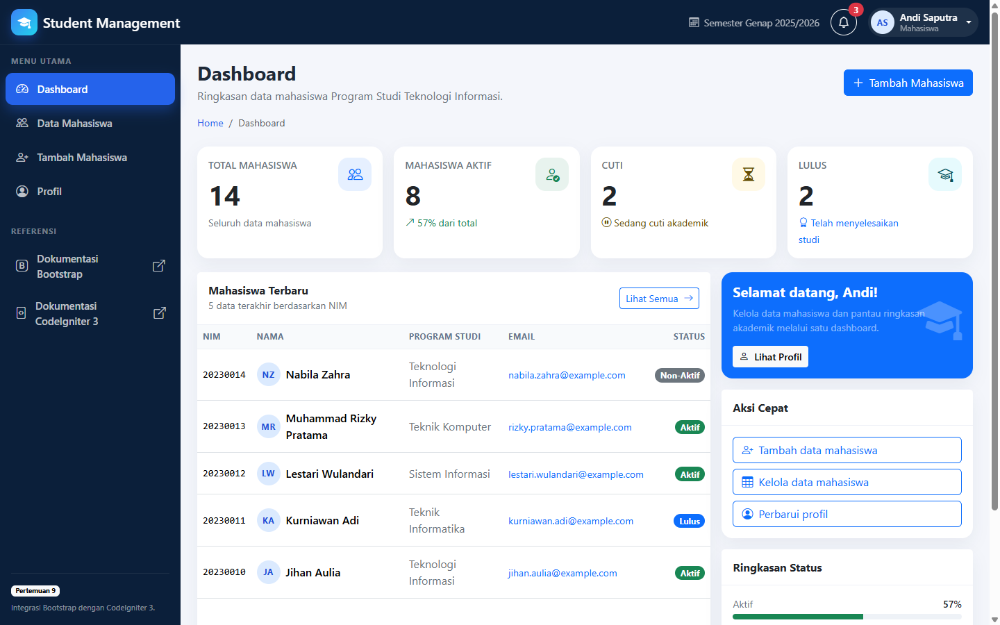

# Praktikum Pertemuan 9 — Integrasi Bootstrap dengan CodeIgniter 3

## Judul Praktikum

**Student Management Dashboard: Mengintegrasikan Template Bootstrap 5.3 ke dalam CodeIgniter 3**

## Deskripsi Praktikum

Praktikum ini membahas cara mengintegrasikan framework CSS **Bootstrap 5.3** ke dalam framework PHP **CodeIgniter 3.1.13**. Mahasiswa tidak hanya diminta menempelkan file CSS, tetapi juga memahami:

- bagaimana aset Bootstrap dipanggil melalui `base_url()`;
- bagaimana konsep MVC menghubungkan controller dan view;
- bagaimana satu template Bootstrap dipecah menjadi partial view yang dapat digunakan ulang;
- bagaimana komponen Bootstrap (navbar, sidebar, card, table, badge, form, pagination) diterapkan pada halaman nyata.

Sebagai media praktik dibuat aplikasi **Student Management Dashboard** dengan empat halaman:

| Halaman | URL | Komponen utama |
|---|---|---|
| Dashboard | `/index.php/dashboard` | Navbar, sidebar, breadcrumb, card statistik, table, progress, footer |
| Data Mahasiswa | `/index.php/mahasiswa` | Table, badge, button, pagination, card |
| Tambah Mahasiswa | `/index.php/mahasiswa/tambah` | Form control, input group, select, validation, alert, button |
| Profil | `/index.php/profil` | Card, grid, form, badge, list group |

> Aplikasi ini **tidak menggunakan database**. Data mahasiswa disediakan sebagai data dummy di `application/models/Mahasiswa_model.php`. Fokus penilaian adalah integrasi Bootstrap dan pemisahan template, bukan pengolahan data.



## Tujuan Pembelajaran

Setelah menyelesaikan praktikum ini, mahasiswa mampu:

1. Menjelaskan fungsi Bootstrap dan CodeIgniter 3 dalam pengembangan aplikasi web.
2. Memasang serta memanggil CSS dan JavaScript Bootstrap secara lokal maupun melalui CDN.
3. Menghubungkan file aset Bootstrap menggunakan `base_url()` pada CodeIgniter 3.
4. Menjelaskan alur MVC: request → route → controller → view.
5. Memecah satu template Bootstrap menjadi komponen `header`, `navbar`, `sidebar`, `footer`, dan `scripts`.
6. Memanggil partial view menggunakan `$this->load->view()`.
7. Membangun antarmuka dashboard responsif dengan komponen Bootstrap.
8. Menguji tampilan pada ukuran desktop dan mobile.

## Teknologi yang Digunakan

| Teknologi | Versi | Keterangan |
|---|---|---|
| PHP | 7.4+ (diuji pada 8.1.34) | Bahasa pemrograman server |
| CodeIgniter | 3.1.13 | Framework PHP dengan pola MVC |
| Bootstrap | 5.3.3 | Framework CSS dan komponen UI |
| Bootstrap Icons | 1.11.3 | Ikon antarmuka (lokal) |
| HTML5 | — | Struktur halaman |
| CSS3 | — | Layout tambahan minimal |
| JavaScript | ES5/ES6 | Validasi form dan offcanvas sidebar |
| Apache / PHP built-in server | — | Local web server |

Bootstrap dan Bootstrap Icons **sudah tersedia secara lokal** di folder `assets/`. CDN hanya dijelaskan sebagai alternatif pada materi `02-integrasi-bootstrap.md`.

## Persyaratan Software

- XAMPP (Apache + PHP) **atau** Laragon **atau** PHP CLI minimal versi 7.4.
- Browser modern: Chrome, Edge, atau Firefox.
- Code editor: VS Code, Sublime Text, Notepad++, atau sejenisnya.
- Tidak memerlukan MySQL karena aplikasi menggunakan data dummy.

## Cara Menjalankan Project

### Opsi A — XAMPP / Laragon

1. Salin seluruh folder project ke direktori web server.
   - XAMPP: `C:\xampp\htdocs\pengantar`
   - Laragon: `C:\laragon\www\pengantar`
2. Jalankan **Apache** dari XAMPP Control Panel atau Laragon.
3. Buka browser dan akses:

   ```text
   http://localhost/pengantar/
   ```

4. Halaman dashboard akan terbuka otomatis karena `default_controller` diarahkan ke `dashboard`.

### Opsi B — PHP Built-in Server

1. Buka terminal di folder project.
2. Jalankan:

   ```bash
   php -S localhost:8080
   ```

3. Buka:

   ```text
   http://localhost:8080/
   ```

> `base_url` pada project ini dibuat **dinamis** di `application/config/config.php`, sehingga aplikasi dapat berjalan di subfolder XAMPP maupun di root PHP built-in server tanpa mengubah konfigurasi. Untuk produksi, tuliskan `base_url` secara eksplisit.

### Halaman yang Dapat Diuji

```text
http://localhost/pengantar/index.php/dashboard
http://localhost/pengantar/index.php/mahasiswa
http://localhost/pengantar/index.php/mahasiswa/page/2
http://localhost/pengantar/index.php/mahasiswa/tambah
http://localhost/pengantar/index.php/profil
```

## Struktur Folder Project

```text
pengantar/
├── application/
│   ├── cache/
│   │   └── sessions/                 # Penyimpanan file session
│   ├── config/
│   │   ├── autoload.php              # Autoload session, helper url & status
│   │   ├── config.php                # base_url, index_page, session
│   │   └── routes.php                # Route dashboard, mahasiswa, profil
│   ├── controllers/
│   │   ├── Dashboard.php
│   │   ├── Mahasiswa.php
│   │   └── Profil.php
│   ├── helpers/
│   │   └── status_helper.php         # status_badge(), avatar_initials()
│   ├── models/
│   │   └── Mahasiswa_model.php       # Data dummy + pagination
│   └── views/
│       ├── dashboard/
│       │   └── index.php
│       ├── mahasiswa/
│       │   ├── index.php
│       │   └── form.php
│       ├── profil/
│       │   └── index.php
│       └── templates/
│           ├── header.php
│           ├── navbar.php
│           ├── sidebar.php
│           ├── footer.php
│           └── scripts.php
├── assets/
│   ├── bootstrap/
│   │   ├── css/bootstrap.min.css
│   │   └── js/bootstrap.bundle.min.js
│   ├── bootstrap-icons/
│   │   ├── bootstrap-icons.min.css
│   │   └── fonts/
│   ├── css/
│   │   └── custom.css
│   └── js/
│       └── app.js
├── docs/
│   └── pertemuan-09/                 # Materi pembelajaran ini
├── system/                           # Core CodeIgniter 3.1.13 (jangan diubah)
├── index.php                         # Front controller CodeIgniter
├── .htaccess                         # Rewrite opsional
├── composer.json
├── license.txt
└── readme.rst
```

## Daftar Materi Praktikum

| No | File | Materi |
|---|---|---|
| 1 | [01-pengantar-bootstrap-codeigniter.md](01-pengantar-bootstrap-codeigniter.md) | Konsep Bootstrap, CodeIgniter 3, MVC, dan hubungan controller–view |
| 2 | [02-integrasi-bootstrap.md](02-integrasi-bootstrap.md) | Integrasi CSS/JS Bootstrap: CDN, lokal, `base_url()`, troubleshooting |
| 3 | [03-memecah-template-bootstrap.md](03-memecah-template-bootstrap.md) | Partial view: header, navbar, sidebar, footer, scripts |
| 4 | [04-langkah-praktikum.md](04-langkah-praktikum.md) | 9 praktikum bertahap dari persiapan sampai uji responsif |
| 5 | [05-pretest-posttest.md](05-pretest-posttest.md) | 10 soal pretest, 10 soal posttest, kunci, dan pembahasan |
| 6 | [06-lembar-kerja-mahasiswa.md](06-lembar-kerja-mahasiswa.md) | Lembar kerja, checklist, dan kolom refleksi |
| 7 | [07-rubrik-penilaian.md](07-rubrik-penilaian.md) | Rubrik skala persepsi 1–4, bobot, dan rumus nilai akhir |
| 8 | [08-rancangan-aktivitas-pembelajaran.md](08-rancangan-aktivitas-pembelajaran.md) | Distribusi waktu 2 × 40 menit + 2 × 3 × 40 menit |

## Peta Capaian Pembelajaran

| Sub-Capaian | Dibuktikan pada |
|---|---|
| a. Mengimplementasikan template Bootstrap ke CodeIgniter | Praktikum 3–4, halaman dashboard |
| b. Mengimplementasikan CSS Bootstrap pada CodeIgniter | Praktikum 3, 5, 7, 8 |
| c. Memecah template Bootstrap | Praktikum 5–6, folder `views/templates/` |

## Catatan untuk Dosen

- Seluruh kode contoh pada materi diambil dari source code project ini.
- Data dummy dapat diganti dengan database pada pertemuan berikutnya tanpa mengubah struktur template.
- Bagian `system/` adalah core CodeIgniter dan tidak boleh diedit.
- File `assets/bootstrap/` dan `assets/bootstrap-icons/` sudah lokal agar praktikum tidak bergantung pada internet.
